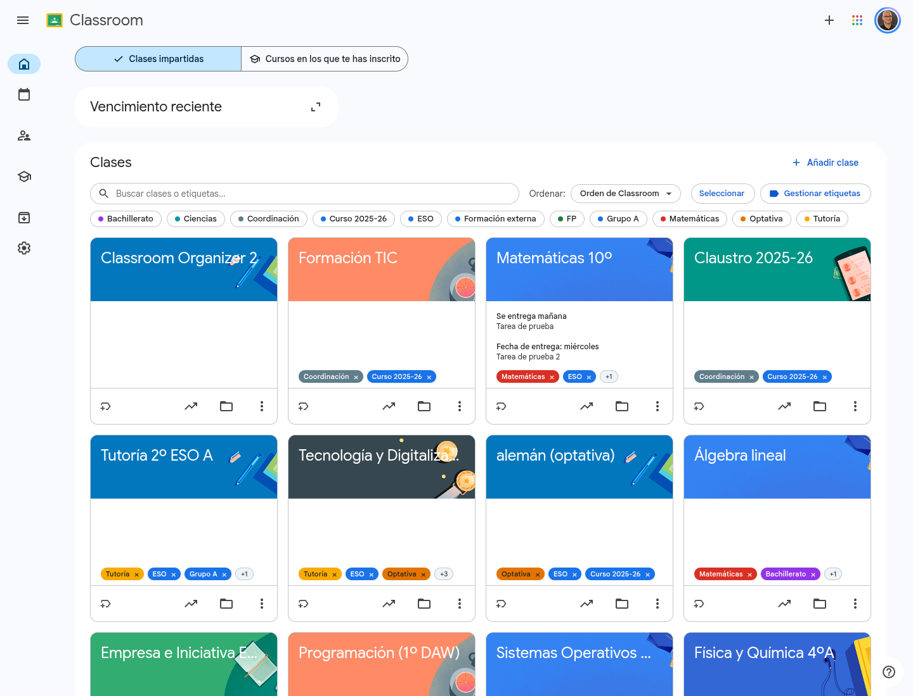

[🇪🇸 Versión en español](README.md) | [🇺🇸 English version](README.en.md)

# Classroom Organizer 🏷️

**Classroom Organizer** és una extensió de Chrome per **etiquetar, cercar, filtrar i ordenar les classes de [Google Classroom](https://classroom.google.com)**, que avui només es poden reorganitzar arrossegant-les una a una. Afegeix una capa d'organització integrada a la pàgina principal de Classroom, que se sent com una funció nativa de la plataforma.

És l'extensió germana de [NotebookLM Organizer](https://github.com/pfelipm/notebooklm-organizer) i en comparteix la manera de treballar.

> 🚧 **En desenvolupament (v0.6.8).** L'extensió està en fase de proves i encara no està publicada a la Chrome Web Store. De moment s'instal·la de manera manual: consulta «Prova la versió de desenvolupament». La captura és provisional; les definitives s'afegiran quan la versió 1.0 estigui a punt per al llançament i la publicació.



---

## 🧪 Prova la versió de desenvolupament

Gràcies per ajudar a provar Classroom Organizer abans de publicar-la! Els teus comentaris són el que més la pot millorar.

### Instal·lar-la
1. Baixa **[classroom-organizer-dev.zip](https://github.com/pfelipm/classroom-organizer/releases/download/dev/classroom-organizer-dev.zip)**. L'enllaç apunta sempre a l'última versió.
2. Descomprimeix-lo en una carpeta que no hagis d'esborrar (per exemple, a *Documents*). A dins hi ha una carpeta anomenada **`classroom-organizer`**.
3. Obre `chrome://extensions`, activa el **Mode de desenvolupador** (a dalt a la dreta), prem **Carrega l'extensió desempaquetada** i tria aquesta carpeta `classroom-organizer`.
4. Obre o recarrega [Google Classroom](https://classroom.google.com).

> ⚠️ Si el teu equip o el teu perfil de Chrome el gestiona el teu centre, és possible que no et deixi activar el mode de desenvolupador. En aquest cas, prova-ho amb el teu perfil personal de Chrome.

### Actualitzar-la sense perdre les teves etiquetes
1. Per si de cas, exporta una còpia de seguretat (botó **↓** del tauler **Gestionar etiquetes**).
2. Torna a baixar el ZIP i substitueix el contingut de la carpeta `classroom-organizer` pel nou.
3. A `chrome://extensions`, prem el botó de recàrrega (**↻**) de Classroom Organizer i recarrega les pestanyes de Classroom.

**No la desinstal·lis per actualitzar-la:** desinstal·lar esborra les teves etiquetes (consulta «Les teves dades»).

### Què ens interessa especialment
- Com es comporta amb **moltes classes** i amb targetes que mostren **feina pendent**.
- Classroom configurat en **altres idiomes** (gallec, basc…): l'extensió es veurà en espanyol, però convé comprovar que tot funciona amb els menús de Classroom en aquest idioma. I el seu ús en **Chromebooks**.
- La **sincronització** entre diversos equips amb el mateix perfil de Chrome.
- Qualsevol cosa que no s'entengui a la primera, es vegi estranya o trobis a faltar.

### Enviar comentaris
Obre una **[incidència a GitHub](https://github.com/pfelipm/classroom-organizer/issues/new/choose)** i tria **🐞 Error** o **💡 Sugerencia** (suggeriment): el formulari et guia. Indica la versió que apareix al peu del tauler **Gestionar etiquetes** i, a les captures, **no hi incloguis dades del teu alumnat**. Si no tens compte de GitHub, escriu-me per [LinkedIn](https://www.linkedin.com/in/pfelipm/).

---

## 🔒 Privadesa i seguretat

Classroom Organizer està dissenyada sota el principi de **mínim accés necessari**:

- **Sense accés al contingut:** l'extensió **en cap moment** llegeix, accedeix ni processa el contingut de les teves classes: ni tasques, ni materials, ni alumnat, ni qualificacions.
- **Només metadades visibles:** de cada classe de la pàgina principal només en llegeix el **nom** i l'**identificador intern** que apareix al seu enllaç. L'identificador serveix per associar-hi les teves etiquetes; la cerca només fa servir el nom de la classe i les seves etiquetes.
- **No modifica res a Classroom:** ordenar, filtrar o etiquetar només canvia **el que veus** al teu navegador. L'ordre de les classes desat a Classroom, els seus noms i la seva configuració no es toquen.
- **Sense API de Classroom ni permisos sensibles:** l'extensió només demana els permisos `storage` i `activeTab` (aquest últim, només en prémer la seva icona) i només actua a `classroom.google.com`.
- **Les teves dades són teves:** les teves etiquetes i preferències es desen al teu compte de Chrome (via Chrome Sync) i només tu hi tens accés.

---

## ✨ Característiques destacades

- 🏷️ **Etiquetatge amb colors:** crea etiquetes amb una paleta de colors per classificar les teves classes visualment. Cada etiqueta nova rep el color menys utilitzat, perquè no es repeteixin.
- 🔍 **Cerca i filtratge:** troba classes a l'instant cercant en els seus noms i etiquetes (sense distingir majúscules ni accents) i combinant-ho amb filtres d'etiquetes amb lògica **I** o **O**.
- 🔤 **Ordre per nom:** ordena la vista alfabèticament (A-Z o Z-A) amb un ordre natural («2n ESO» abans que «10è»). El tauler lateral de Classroom segueix el mateix ordre.
- ✅ **Etiquetatge múltiple:** selecciona diverses classes (clic, Maj+clic o «Selecciona les visibles») i aplica o treu etiquetes a totes alhora, amb opció de desfer.
- ⭐ **Etiquetes prioritàries:** marca amb una estrella les etiquetes que vols veure sempre primer a cada classe.
- 📐 **Etiquetes ajustades a l'espai:** cada targeta mostra tantes etiquetes com hi caben i agrupa la resta en «+N».
- 👩‍🏫 **A totes les vistes:** funciona a «Cursos impartits», «Cursos on us heu inscrit» i «Classes arxivades».
- 🎛️ **Tauler de gestió complet:** crea, reanomena, acoloreix i elimina etiquetes veient quantes classes té cadascuna, amb filtre ràpid, contrast automàtic del text i mesurador de l'emmagatzematge sincronitzat.
- 🔄 **Sincronització automàtica:** les teves etiquetes i preferències se sincronitzen entre tots els teus dispositius mitjançant el teu compte de Chrome.
- 💾 **Còpies de seguretat:** exporta i importa la teva configuració en format JSON, triant quines parts vols restaurar.
- 🌐 **Multiidioma:** interfície en **espanyol, anglès i català**, amb canvi d'idioma instantani des del tauler de gestió. Amb Chrome en gallec o basc es mostra en espanyol.
- 🚀 **Accés ràpid:** fes clic a la icona de l'extensió per obrir Google Classroom en una pestanya nova (si ja ets a Classroom, no fa res).

---

## 🧰 Organització avançada

### 🔍 Cerca
El quadre de cerca, damunt de la llista de classes, troba classes mentre escrius:

- **On cerca:** en el **nom de la classe** i en els noms de **totes les seves etiquetes** (encara que alguna no es vegi a la targeta perquè està agrupada en «+N»).
- **Sense distingir majúscules ni accents:** «fisica» troba «Física i Química».
- **Troba parts de paraules:** «mate» troba «Matemàtiques», i «quím» troba «Física i **Quím**ica».
- **Diverses paraules:** hi han d'aparèixer **totes**, en **qualsevol ordre** i en el nom o en les etiquetes: «fís 4» troba «Física i Química 4t ESO A»; «eso grup» troba les classes amb les etiquetes «ESO» i «Grup A».
- **Buidar la cerca:** prem **Esc** al quadre o el botó **✕** que apareix a la seva dreta.

### 🏷️ Filtres per etiqueta
Sota el quadre de cerca apareixen totes les teves etiquetes: prem-ne una per veure només les classes que la tenen i torna-la a prémer per treure el filtre.

- Amb **dues o més etiquetes actives** apareix el selector **I / O**:
  - **I:** classes que tenen **totes** les etiquetes seleccionades.
  - **O:** classes que en tenen **alguna**.
- La cerca i els filtres es combinen: es mostren les classes que compleixen totes dues condicions.
- El recompte («7 de 14 classes») indica quantes se'n veuen; **Neteja els filtres** treu alhora la cerca i les etiquetes actives.
- La cerca i els filtres es mantenen en canviar entre «Cursos impartits», «Cursos on us heu inscrit» i «Classes arxivades». El mode I/O es desa.

### ✅ Etiquetatge múltiple
1. Prem **Selecciona** a la barra de l'extensió. Apareixen una casella a cada targeta i una barra flotant a la part inferior.
2. Marca les classes: un **clic** a qualsevol part de la targeta en selecciona una (sense obrir-la), **Maj+clic** selecciona un interval en l'ordre en què es veuen i **Selecciona les visibles** hi afegeix totes les que mostren la cerca i els filtres actius. **Espai** marca la targeta que té el focus.
3. Prem **Etiqueta**. Cada etiqueta indica si la tenen totes les classes seleccionades, algunes (amb el seu recompte) o cap: en prémer-la s'afegeix a totes o, si ja la tenen totes, es treu de totes. També pots crear una etiqueta nova i aplicar-la a la selecció.
4. Després de cada canvi apareix un avís amb **Desfés** durant uns segons. Si tanques la finestra després d'algun canvi, el mode selecció s'acaba; si la tanques sense canvis, la selecció es conserva.

**Esc** tanca la finestra d'etiquetatge i, si el tornes a prémer, surt del mode selecció (si estàs escrivint al quadre de cerca, primer el buida). En canviar de vista també se surt del mode selecció.

### ⭐ Etiquetes prioritàries
Al tauler de gestió, l'**estrella** de cada etiqueta la marca com a prioritària: a totes les classes es mostrarà abans que les altres, de manera que serà l'última a quedar amagada darrere de «+N». Entre diverses prioritàries, i també entre la resta, es respecta l'**ordre en què es van assignar a cada classe**.

### 📐 Etiquetes a cada classe
- Les etiquetes apareixen a la part baixa de cada targeta, alineades amb el nom de la classe. Si Classroom mostra feina pendent a la targeta, l'extensió hi deixa lloc perquè mai no quedi tapada.
- Cada targeta mostra tantes etiquetes com hi caben i agrupa la resta en **«+N»**; si el prems, les veus totes. En passar el punter per una etiqueta, la llista completa només apareix si n'hi ha alguna d'amagada o si el seu nom està retallat.
- La **×** de cada etiqueta la treu d'aquella classe.
- El botó d'**etiqueta** de la fila inferior de la targeta (al costat de les icones de Classroom) obre la finestra d'etiquetatge d'aquella classe. Apareix en passar el punter per la targeta; a les pantalles tàctils es veu sempre.
- A la finestra d'etiquetatge, **Retorn** aplica l'etiqueta amb aquest nom o, si no n'hi ha cap, la primera de la llista filtrada («mate» → Matemàtiques); només crea una etiqueta nova si no hi coincideix res.

### 🔤 Ordre de la vista i reorganització manual
- El selector **Ordena** ofereix «Ordre de Classroom» (el teu), «Nom (A-Z)» i «Nom (Z-A)». El tauler lateral segueix el mateix ordre.
- Ordenar **només canvia el que veus**: l'ordre desat a Classroom no es modifica i torna tan bon punt tries «Ordre de Classroom».
- Mentre la vista està ordenada per nom, filtrada o en mode selecció, la **reorganització manual de Classroom** (arrossegar targetes o l'opció «Mou» del seu menú) queda **en pausa**, perquè s'aplicaria sobre una vista diferent de la real. Un avís sota la barra ho recorda.

---

## 🛠️ Instal·lació

### Chrome Web Store
*Properament.* Serà la manera recomanada d'instal·lar-la i l'única possible en molts centres educatius, on l'administrador de Google Workspace la pot instal·lar a tots els equips del claustre.

### Instal·lació manual (mode de desenvolupador)
Per revisar-ne el codi o contribuir-hi (per provar-la, és més senzill seguir «Prova la versió de desenvolupament»):

1. Baixa i descomprimeix el fitxer ZIP o clona aquest repositori al teu equip.
2. Obre Google Chrome i ves a `chrome://extensions`.
3. Activa el **Mode de desenvolupador** (a dalt a la dreta).
4. Prem **Carrega l'extensió desempaquetada** i tria la carpeta **`extension`** del projecte.
5. Obre o recarrega [Google Classroom](https://classroom.google.com).

> ⚠️ En molts centres educatius, els equips i perfils de Chrome gestionats pel centre **no permeten** el mode de desenvolupador ni les extensions carregades a mà. En aquest cas caldrà esperar la versió de la Chrome Web Store.

**Per actualitzar una instal·lació manual** no cal desinstal·lar-la (i és millor no fer-ho: consulta la secció «Les teves dades»). Substitueix els fitxers de la carpeta pels de la versió nova i prem el botó de recàrrega (↻) de l'extensió a `chrome://extensions`. Després, recarrega les pestanyes de Classroom que tinguis obertes.

---

## 💾 Les teves dades: on es desen i quan es poden perdre

### On es desen
Les teves etiquetes, la seva assignació a les classes i les teves preferències es desen a **Chrome Sync**, l'emmagatzematge sincronitzat del teu perfil de Chrome. Així estan disponibles a tots els equips on facis servir aquest perfil amb l'extensió instal·lada. Chrome permet uns **100 KB** per extensió; el tauler de gestió mostra quant se n'utilitza i l'extensió avisa en passar del 80 % i si mai falla la sincronització.

### Còpies de seguretat
Al tauler de gestió, el botó **↓** exporta tota la teva configuració a un fitxer JSON (`classroom-organizer-AAAA-MM-DD.json`) i el botó **↑** la importa. En importar pots triar quines parts substitueixen les actuals: **etiquetes**, **etiquetatge de classes** i **preferències**. El fitxer es revisa abans d'importar-lo, de manera que un fitxer malmès o d'una altra extensió es rebutja sense tocar les teves dades.

**La còpia de seguretat és la xarxa de seguretat universal:** fes-ne una de tant en tant i, sobretot, abans de desinstal·lar l'extensió o de passar de la instal·lació manual a la de la botiga.

### Instal·lació des de la botiga i manual
La via oficial d'instal·lació és la **Chrome Web Store**. La instal·lació manual existeix per provar l'extensió, revisar-ne el codi o contribuir-hi, i té algunes diferències:

- **Mateix identificador a totes les instal·lacions manuals:** el `manifest.json` inclou una clau pública (`key`) que dona a l'extensió sempre el mateix ID (`lolmnldccjfekckioeldgcolppkcalim`), sigui quina sigui la carpeta des de la qual es carregui. Així, Chrome Sync reconeix que és la mateixa extensió a tots els teus equips. Encara que l'ID sigui el mateix per a tothom, les teves dades continuen vinculades exclusivament al teu compte.
- **Còpia local de reserva:** a les instal·lacions manuals, l'extensió també desa una còpia al mateix equip. Si en obrir Classroom el núvol és buit (per exemple, perquè has desinstal·lat l'extensió en un altre equip), recupera aquesta còpia i la torna a pujar.
- **Avís al tauler:** el tauler de gestió recorda que convé exportar abans de desinstal·lar, i al costat de la versió apareix «(dev)».
- La versió de la botiga té **un altre ID**, de manera que les seves dades i les d'una instal·lació manual **no es comparteixen**: per passar de l'una a l'altra, exporta en una i importa en l'altra.

### Quan es poden perdre (o deixar de veure) les dades

| Situació | Què passa | Com evitar-ho |
|---|---|---|
| Desinstal·lar l'extensió (de la botiga o manual) | Chrome esborra les seves dades sincronitzades del teu compte i, amb la sincronització activada, també als teus altres equips | Exportar una còpia abans de desinstal·lar |
| Desinstal·lar en un equip quan un altre té una instal·lació manual | En obrir Classroom a l'equip que la conserva, la seva còpia local reposa les dades al núvol | Mantenir-la instal·lada en almenys un equip, o exportar |
| Passar de la instal·lació manual a la de la botiga (o a l'inrevés) | Són extensions amb IDs diferents: les dades **no es comparteixen** (no es perden, però no es veuen) | Exportar en una i importar en l'altra |
| Carregar una versió manual anterior a la 0.6.0 o amb una altra `key` | L'ID és diferent: les dades desades amb l'altre ID deixen de veure's | Exportar abans i importar després |
| Perfil de Chrome sense sessió iniciada o amb la sincronització d'extensions desactivada | Les dades només són en aquell equip i es perden en desinstal·lar o en esborrar el perfil | Iniciar sessió a Chrome amb la sincronització activada, o exportar |
| Emmagatzematge de Chrome Sync ple (uns 100 KB) | Els canvis deixen de sincronitzar-se (l'extensió avisa) | Exportar i eliminar etiquetes que ja no facis servir |
| Diversos perfils de Chrome (per exemple, el personal i el del centre) | Cada perfil té les seves dades; no es barregen | Exportar en un perfil i importar en l'altre si les vols compartir |

### Per què no hi ha un sistema de conciliació com a NotebookLM Organizer?
NotebookLM Organizer inclou un mecanisme elaborat per a les instal·lacions manuals: còpia local i al núvol, tres modes de seguretat i un assistent que compara totes dues còpies i permet fusionar-les. A Classroom Organizer s'ha optat deliberadament per una cosa més senzilla:

- Els docents solen treballar amb **Chromebooks o perfils gestionats pel seu centre**, on l'administrador gairebé sempre bloqueja el mode de desenvolupador. La instal·lació manual serà l'excepció.
- La via natural en un centre és la **instal·lació des de la Chrome Web Store**, que l'administrador pot forçar a tots els equips.
- Fins i tot amb la versió de la botiga, desinstal·lar esborra les dades sincronitzades: la **còpia de seguretat exportada** protegeix en tots els casos.

Per això es mantenen només les peces senzilles i eficaces: l'ID fix, la còpia local amb recuperació automàtica, els avisos i l'exportació i importació.

---

## ⚙️ Detalls tècnics

- **Sense frameworks ni dependències:** JavaScript i CSS estàndard, sense empaquetador. Els scripts es carreguen en ordre des del manifest i comparteixen un espai de noms (`CO`).
- **Manifest V3.**
- **Un únic mòdul coneix la pàgina de Classroom** (`src/classroom/adapter.js`): tots els selectors hi són i fan servir atributs estables (de dades i d'accessibilitat), mai les classes internes de Google. Si Classroom canvia, s'arregla en un sol lloc.
- **Aplicació d'una sola pàgina:** Classroom no recarrega la pàgina en canviar de vista i conserva amagades les vistes anteriors. L'extensió vigila els canvis amb un `MutationObserver` i treballa sempre sobre la vista visible.
- **Ordre sense tocar la pàgina:** l'ordre per nom fa servir la propietat CSS `order` sobre les targetes i els enllaços del tauler lateral, sense moure'ls, i la reorganització manual de Classroom es posa en pausa interceptant-ne els esdeveniments.
- **Chrome Sync fragmentat:** les dades es divideixen en fragments mesurats en bytes reals per respectar el límit de 8 KB per element. Els fragments nous s'escriuen abans d'esborrar els sobrants, de manera que una escriptura fallida mai no deixa el núvol buit.
- **Recàrrega segura:** si l'extensió s'actualitza o es recarrega amb Classroom obert, la còpia antiga de l'script detecta que s'ha quedat desconnectada i es retira netament, sense errors.
- **Permisos:**
  - `storage`: per desar i sincronitzar les teves etiquetes i preferències.
  - `activeTab`: només en prémer la icona de l'extensió, per comprovar si la pestanya actual ja és Classroom i, si no ho és, obrir-lo en una pestanya nova.
  - L'accés a `classroom.google.com` és el del mateix script de contingut.

### Estructura del codi

```
extension/
├── manifest.json
├── background.js            Clic a la icona → obre Classroom
├── styles.css               Estils (només tema clar: Classroom no té mode fosc)
├── _locales/               Traduccions es, en, ca (gl i eu: còpies de l'espanyol)
└── src/
    ├── core/                i18n.js, store.js (Chrome Sync), tags.js (model d'etiquetes)
    ├── classroom/           adapter.js: l'ÚNIC mòdul que coneix la pàgina de Classroom
    ├── features/            view-order.js, drag-lock.js, filters.js, selection.js, backup.js
    ├── ui/                  barra, etiquetes de les targetes, finestres, tauler de gestió, avisos
    └── content.js           Arrencada i cicle d'actualització
scripts/package-webstore.py  Genera el ZIP per a la Chrome Web Store (sense la "key")
scripts/sync-locales.py      Copia les traduccions en espanyol a gl i eu (executar-lo després de canviar-les)
assets/                      Fonts de la icona
```

> **Per publicar la teva pròpia versió a la Chrome Web Store:** executa `python3 scripts/package-webstore.py`. Genera `classroom-organizer-vX.Y.Z.zip` a partir de la carpeta `extension` però **sense la propietat `key`** del manifest, que la botiga no admet (hi assigna el seu propi ID). Així només hi ha un manifest per mantenir.

---

## 📝 Nota sobre el manteniment

Classroom Organizer funciona analitzant l'estructura de la pàgina de Google Classroom, que Google pot canviar en qualsevol moment sense avís previ. El manteniment davant d'aquests canvis es farà de manera voluntària; és un projecte impulsat per la comunitat i el codi obert.

---

## 🤝 Crèdits

Aquest projecte ha estat creat i és mantingut per **Pablo Felip** ([LinkedIn](https://www.linkedin.com/in/pfelipm/) | [GitHub](https://github.com/pfelipm)).

---

## 📄 Llicència

Aquest projecte es distribueix sota els termes de la [GNU Affero General Public License v3.0](LICENSE).
